<a href="https://github.com/vaibhav2616">
  
</a>

  
  
  
  

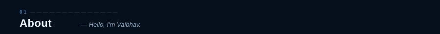



<a href="https://github.com/vaibhav2616"></a>

  

<a href="https://github.com/vaibhav2616"></a>

  

<a href="https://github.com/vaibhav2616">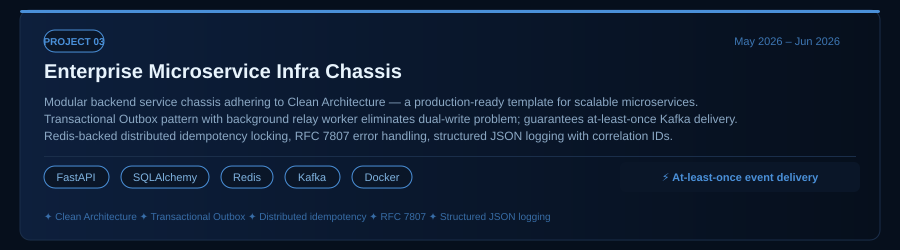</a>

  

<a href="https://github.com/vaibhav2616"></a>

  



  


  
  
  
  

